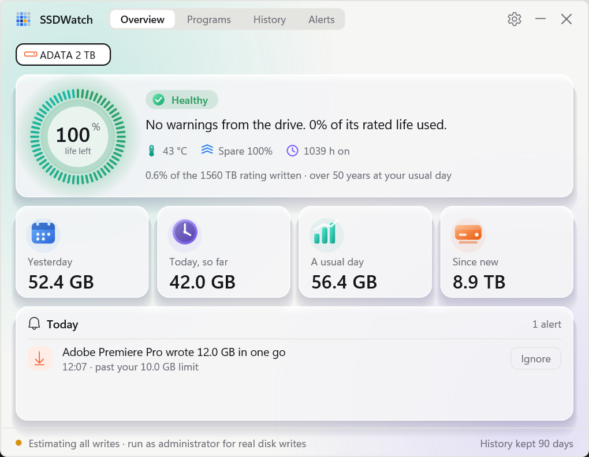
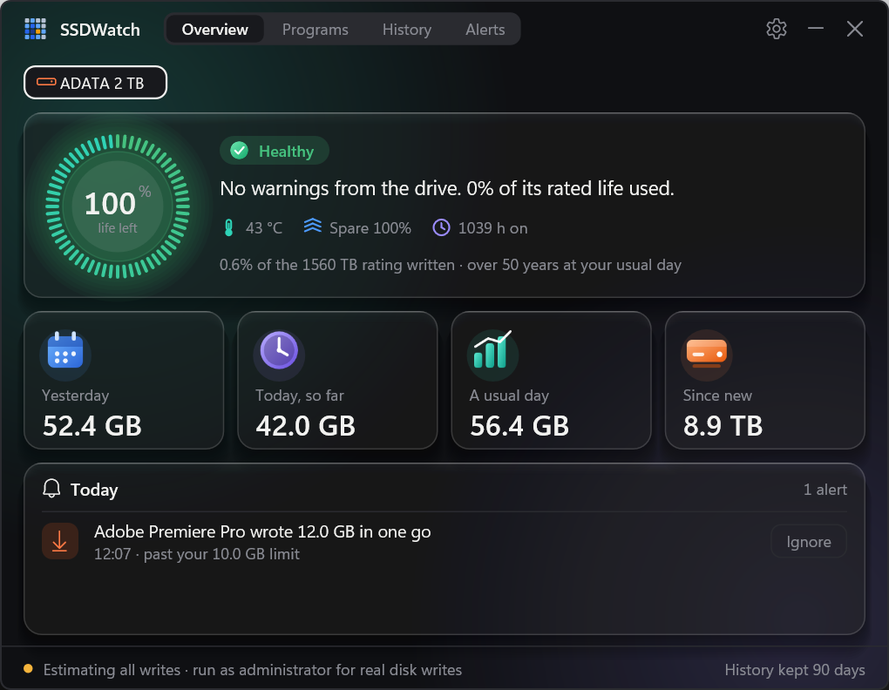
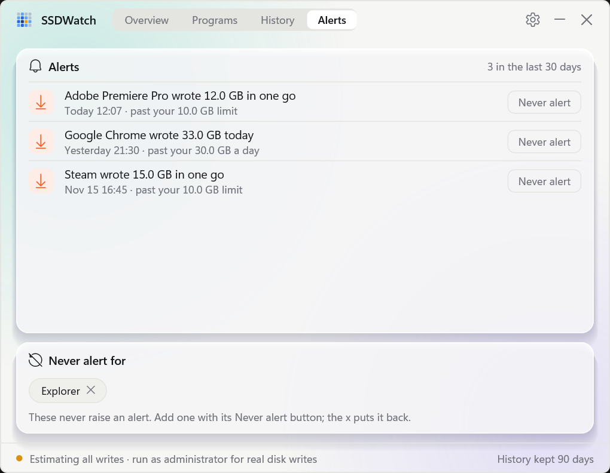
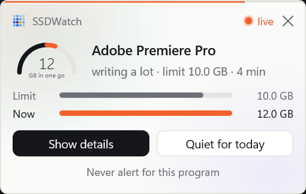
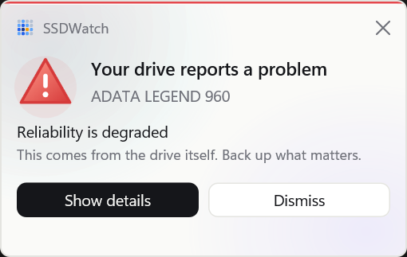

<p align="center">
  
</p>

# SSDWatch

**SSDWatch shows how much your SSD receives every day, which programs wrote it, and how healthy the drive is.** It sits in the tray, keeps a day-by-day history, and warns you when a program writes a lot in one go or in a day, when a drive passes a limit you set, or when the drive itself reports a problem. Nothing it warns about depends on a "usual" day it has to learn first. It is a small native Windows program: no account, no telemetry, nothing sent anywhere.

<!-- DRAFT: this story is a first draft written for you to correct or rewrite in your own words. -->
## Why use it?

SSDs wear out as they are written, and you never knew how much was being written, or by whom. Windows shows that a disk is busy, but not what it received over a day, which program was behind it, or whether today is normal. The tools that tell you the health of a drive show one number; the ones that show per-program activity forget everything when you close them.

I wanted one small program that answers the simple questions: how much did my SSD get today, who wrote it, is that a normal day, and is the drive still healthy? SSDWatch is that program. Like Vizor, it was built with AI, but every design decision and every detail was mine, and each change was tried in the real program before it was saved.

## Screenshots

<p align="center"></p>

<table>
<tr>
<td width="50%"></td>
<td width="50%"></td>
</tr>
<tr>
<td></td>
<td></td>
</tr>
<tr>
<td></td>
<td valign="top">
<br><br>

</td>
</tr>
</table>

## Features

- **An overview anyone can read.** One chip per SSD, a health verdict (Healthy, Running hot, Near its rated life, Back up this drive) that comes only from what the drive reports about itself, and four figures: yesterday, today so far, a usual day and the total written since the drive was new. Those figures come from the drive's own counter, so they include the time SSDWatch was closed.
- **Alerts you choose, none of them learned from your history:**
  - a program writing more than an amount in one continuous session (1 to 500 GB);
  - a program writing more than an amount in one day (10 to 500 GB, on by default at 30 GB);
  - a drive receiving more than a limit in a day, 7 days or 30 days (off by default);
  - the drive reporting a critical warning, which is always on.

  An alert can be closed, a program quieted until tomorrow, or a program left out for good. Explorer is left out by default, because the copies you start yourself are expected to write a lot.
- **An alert log.** The Alerts tab lists what was raised in the last 30 days and the programs that never alert, which you can put back with one click.
- **Who wrote today.** Every program, with how much it wrote today, in the last 7 days or in 30 days, and a 30-day chart for each one.
- **Real disk writes.** With administrator rights, SSDWatch counts what really reaches the drive, including what Windows writes later from its cache, and gives it to the program that wrote the file. Without them, it estimates from the programs' own counters.
- **Health and wear.** For NVMe drives: percentage of life used, spare blocks, temperature, hours on and critical warnings, read from the drive itself.
- **Rated endurance (TBW), if you give it.** A drive does not say its own rating, so you choose it from a list in Settings, taken from the maker's spec sheet. SSDWatch then shows how much of it is written and, once it knows enough days, about how many years that is at your usual pace. Until you give it, a small blue mark in the Overview asks for it; nothing is guessed.
- **History per drive.** One small file per day, kept 30, 90 or 365 days. Bars per drive that you switch on and off with a chip, a table of today, the last week and the last month, and the programs of any day. Export to CSV.
- **Several SSDs.** Every NVMe and SATA SSD is found and can be watched or left out. Hard disks are left out.
- **Tray.** It keeps watching from the tray. The icon turns orange during an alert; a click opens the window, and resting the mouse on it shows each drive's health, temperature and what it received today.
- **Starts with Windows,** with administrator rights and without asking each time, through a scheduled task that you turn on once in Settings.
- **Light and dark,** following Windows or chosen by you, with glass-style cards and pictures drawn as SVG. Tips on every control, which you can turn off.

## Download and install

Download `SSDWatch-0.3.0-Setup.exe` from the [Releases](https://github.com/edukode-lab/SSDWatch/releases) page and run it. It asks for administrator rights once, installs SSDWatch in `Program Files`, adds it to the Start menu and, if you leave the box checked, sets it to start with Windows. Updating is the same: run the new installer over the old one. Your history and settings are kept.

To remove it, use **Installed apps** in Windows. The uninstaller also removes the "start with Windows" task, and asks whether to delete your history and settings too.

**Check your download.** Every release lists the **SHA-256** of the installer. After downloading, compare it with the one on the Releases page. In PowerShell:

```powershell
Get-FileHash .\SSDWatch-0.3.0-Setup.exe -Algorithm SHA256
```

If the two values are not identical, do not run the program. Delete it and download it again from this page.

> [!WARNING]
> **Download SSDWatch only from this repository or from well-known, trusted sites.** Unofficial copies, mirrors and files shared by strangers can hide malware. If you are not sure where a file came from, do not run it.

> [!NOTE]
> **Windows SmartScreen or your antivirus may warn you.** SSDWatch is a new program from an independent developer and is not yet signed with a code-signing certificate. It also reads disk activity and, if you ask it to, creates a task that starts it with Windows, which some antivirus programs treat with suspicion. If you downloaded it from this page, choose **More info** and then **Run anyway**.

**Administrator rights.** SSDWatch works without them, estimating what each program writes. To count the real writes to the drive it needs administrator rights: use **Restart as administrator** in Settings, or turn on **Start with Windows**, which asks once and then starts it with those rights at every sign-in.

**SSDWatch is version 0.3.0. Use it at your own risk.** It only reads information from your drives and from Windows, and it does not change your files, but its numbers are measurements and estimates, not guarantees. It is provided "as is", without warranty, as the [license](LICENSE.md) explains. If you find a problem, please [open an issue](https://github.com/edukode-lab/SSDWatch/issues).

## Technical details

- **Requirements:** Windows 10 (version 1703 or later) or 11, 64-bit. Health and wear need an NVMe SSD; SATA SSDs show their writes only.
- **A native Windows program,** written in C with Win32, Direct2D and DirectWrite. It has no framework to install and needs no Visual C++ redistributable.
- **How it measures:** with administrator rights, Windows' own event tracing (ETW) gives every write that reaches a disk and the program behind it; the drive's SMART log gives the counters of the drive itself. Without administrator rights, the programs' I/O counters are used, which include writes that never reach the disk.
- **Where it keeps things:** the history (one CSV file per day), the alert log of the last 30 days (`alerts.log`) and a log of the program itself in `%LOCALAPPDATA%\SSDWatch`; the settings in `%APPDATA%\SSDWatch`. Both survive an update, and a version that kept its history next to the program moves it there by itself. "Start with Windows" is a scheduled task named `SSDWatch`, which you can see and remove in Task Scheduler.
- **What it never guesses:** the health verdict comes only from the drive's own report, and the years left only appear when you have given the rated TBW. Estimates are labeled as estimates and are never shown as a warning in red; red is reserved for what the drive itself reports as critical.
- **Light on the computer:** it looks once a second and keeps its history in a few kilobytes a day.

### Privacy

SSDWatch does not collect or send any data about you. It has no telemetry and no accounts, and it never connects to the internet. The only link is the **Open on GitHub** button of the About window, which opens this page in your browser when you press it.

## License

SSDWatch is free for personal, educational and non-profit use. Commercial use needs a commercial license.
Read the full terms in [LICENSE.md](LICENSE.md) (English) or [LICENCIA.md](LICENCIA.md) (Spanish; it prevails if they differ).

## Support

If you like SSDWatch and want to support its development, you can buy me a coffee.

<a href="https://ko-fi.com/edukode"></a>

